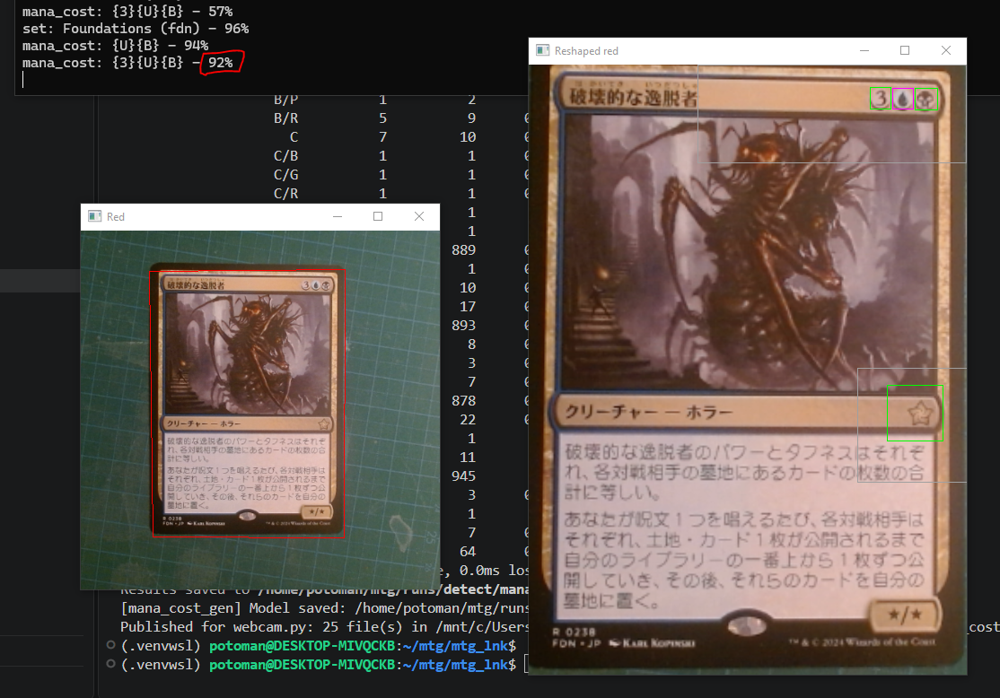

+++
title = 'Data Augmentation for the Mana Cost'
date = 2026-11-08T00:00:00+09:00
draft = false
type = 'posts'
tags = ['Machine Learning', 'Computer Vision', 'Personal Project']
summary = "A fully configurable, generated training set for the mana cost detector of the Magic: The Gathering card detector: validation accuracy goes from 80% to 97%."

[cover]
  image = "mana_cost_best.png"
  alt = "The mana cost {3}{U}{B} of a Magic: The Gathering card detected at 92% from a webcam"
  hiddenInSingle = true
+++

## Use data augmentation for the training set

Instead of relying on a pseudo-automated labeling of real cards, I chose a fully configurable data augmentation to generate a dataset that has a better chance of covering the existing cards. It also increases the chance of recognizing mana symbols that were printed only a few times, like snow or Phyrexian hybrid mana.

## Results

The new dataset improves the training process and gives a good result on the validation dataset, going from **80% to 97% accuracy**.

The recognition of the `{3}{U}{B}` mana cost with the webcam increases from **83% to 92%**.

## Better image alterations

I also improved the dataset alterations by modifying the color and the brightness, and by reducing the blur: I removed the kernel size 7. This kernel destroyed too much of the initial image, and it didn't produce images close to the actual images the model would be used on.

This is part of the broader [Magic: The Gathering Search Engine by AI Recognition](/projects/magic-tcg-ai-recognition/) project.

**Source:** [github.com/Potoman/MtgDetector](https://github.com/Potoman/MtgDetector)
