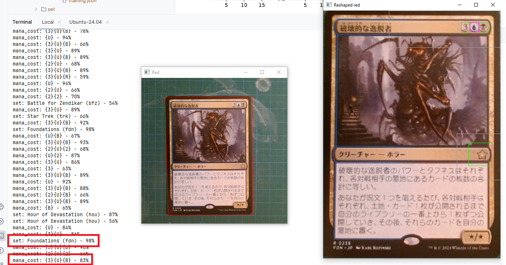

+++
title = 'Detect the Set and the Mana Cost'
date = 2026-11-03T00:00:00+09:00
draft = false
type = 'posts'
tags = ['Machine Learning', 'Computer Vision', 'Personal Project']
summary = "Two new features for the Magic: The Gathering card detector: detecting and printing a card's set and mana cost, now with YOLO for every stage."

[cover]
  image = "set_and_mana_cost.png"
  alt = "A Magic: The Gathering card with its set symbol and mana cost detected by YOLO"
  hiddenInSingle = true
+++

I added two main features to the [card recognition pipeline](/projects/magic-tcg-ai-recognition/): detecting and printing a card's **mana cost** and its **set**.

On the picture below, you can see that both the set (*Foundations*, 98%) and the mana cost (`{3}{U}{B}`, 83%) are correctly detected.

## YOLO for everything

I now use YOLO for every stage of the pipeline. Its training is straightforward and its results are very good.

I've also read about other open-source and free implementations of YOLO-like models; I'll try them another time.

## Room for improvement on the mana cost

I think the mana cost detection could be improved by generating a dataset, instead of relying on a pseudo-automated labeling of real cards that can inject mistakes. Indeed, not all Magic cards have their mana cost at the exact same position in the top-right corner, so a labeling based on a fixed position is sometimes wrong.

## Faster scripts under WSL

I also increased the speed of the scripts since I started running them in WSL. Moving the images out of `/mnt/c` and into the Linux filesystem greatly reduced the file access time.

This is part of the broader [Magic: The Gathering Search Engine by AI Recognition](/projects/magic-tcg-ai-recognition/) project.

**Source:** [github.com/Potoman/MtgDetector](https://github.com/Potoman/MtgDetector)
