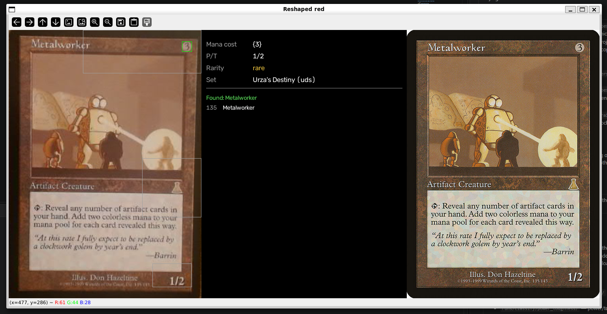

+++
title = 'Set + Rarity and Power + Toughness Detection Works'
date = 2026-11-22T00:00:00+09:00
draft = false
type = 'posts'
tags = ['Machine Learning', 'Computer Vision', 'Personal Project']
summary = "The Magic: The Gathering card detector now recognizes the set with its rarity and the power/toughness, then searches for the cards that match all the detected information."

[cover]
  image = "card_found.png"
  alt = "The Magic: The Gathering card Metalworker found from its detected mana cost, power/toughness, rarity and set"
  hiddenInSingle = true
+++

## Set and rarity

About the set and rarity, the main problem was the generation of the training dataset. Set symbols don't all follow the same rules to be colorized, especially the Commander sets, which contain a white touch. I haven't managed this case yet. It could be complex in some respects.

So, to detect the set and the rarity, two possibilities exist. The first one is to have two outputs: the set and the rarity. The second option is to have one output: the set with its rarity.

For the first choice, the problem is that YOLO detection is not designed to easily have two outputs, as far as I understood. It means that for the first option, we would first need to detect the set symbol shape, then use another classifier to detect the rarity.

For convenience and as a first try, I chose the second way: computing the set with its rarity directly. The problem is that it creates more classes: close to 750, instead of 3 classes for the rarity and around 233 for the set. That gives more work to YOLO and requires a bigger training dataset.

Anyway, I get pretty good results.

Some things are not supported yet: timeshifted set symbols (purple), alternative frames, etc. I'm targeting a first version that matches almost all of the usual frames.

## Power and toughness

I continued my work with the power and toughness, which just requires a classifier. It was pretty easy and quickly done.

## Find the card

The last work was to find all the cards that match the detected information, and to print the found card if there is one result.

On the picture below, the card *Metalworker* is found from its detected mana cost (`{3}`), power/toughness (`1/2`), rarity (rare) and set (*Urza's Destiny*).

This is part of the broader [Magic: The Gathering Search Engine by AI Recognition](/projects/magic-tcg-ai-recognition/) project.

**Source:** [github.com/Potoman/MtgDetector](https://github.com/Potoman/MtgDetector)
