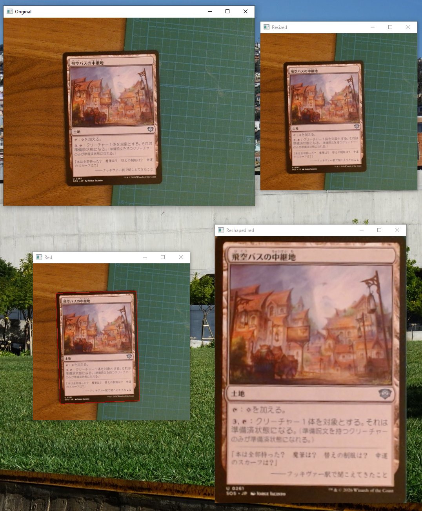
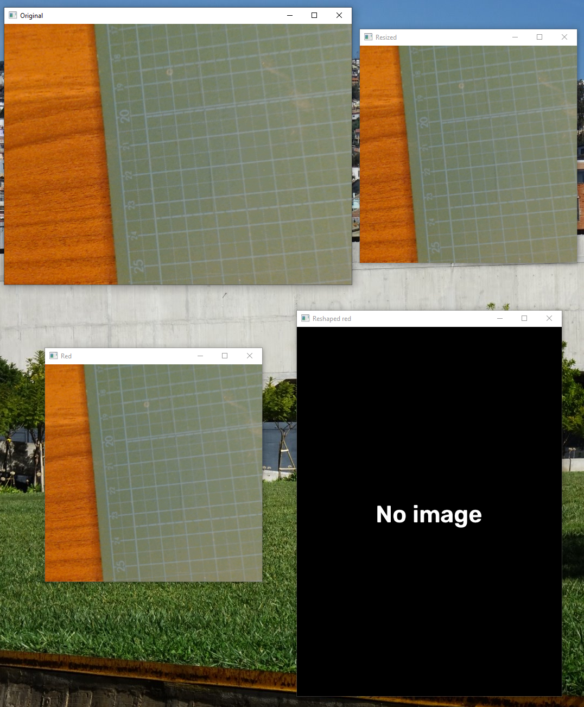

+++
title = 'Use Yolo Pose from Ultralytics'
date = 2026-10-25T00:00:00+09:00
draft = false
type = 'posts'
tags = ['Machine Learning', 'Computer Vision', 'Personal Project']
summary = "Repurposing Ultralytics' YOLO Pose model to find a Magic: The Gathering card's corners, trained entirely on a synthetic dataset generated from Scryfall — no manual labeling."

[cover]
  image = "detected_card.png"
  alt = "A Magic: The Gathering card detected and outlined by the YOLO Pose model"
  hiddenInSingle = true
+++

The first stage of the [card recognition pipeline](/projects/magic-tcg-ai-recognition/) needs to isolate the card from the background before anything else can run. I built this corner-detection step on **YOLO Pose from Ultralytics**: instead of using it to find body keypoints, I repurposed it to find the four corners of a card, treating each corner as a "keypoint" to predict. Once the model outputs the four corner points, the card is straightened with a perspective warp, cleanly separating it from the background before any recognition happens.

When no card is presented to the camera, the model simply finds nothing to warp, and the pipeline reports no detection instead of guessing.

## Training without manual labeling

Training a pose model normally means manually annotating corner keypoints on thousands of images — I skipped that entirely by generating the training dataset instead:

- I used the **Scryfall** API to download the full Magic: The Gathering card database along with the card images for every card.
- Each card image was then synthetically composited onto varied backgrounds, with randomized position, rotation, scale, and perspective distortion, giving me the exact corner coordinates for free since I controlled the compositing.

This generated dataset gave the model thousands of labeled examples without a single manual annotation, while still covering the range of angles and lighting a real camera would see.

This is part of the broader [Magic: The Gathering Search Engine by AI Recognition](/projects/magic-tcg-ai-recognition/) project.

**Source:** [github.com/Potoman/MtgDetector](https://github.com/Potoman/MtgDetector)
