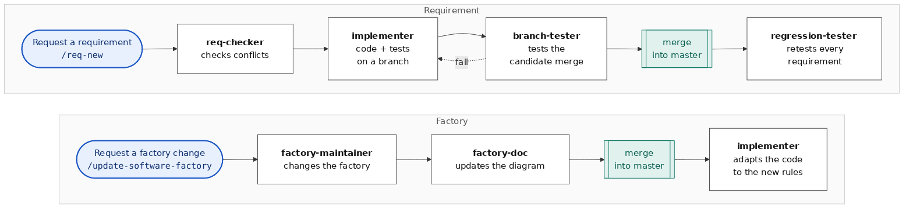

+++
title = 'SmallSoftwareFactory: An Unsupervised Software Factory Run by AI Agents'
date = 2026-11-28T00:00:00+09:00
draft = false
tags = ['AI Agents', 'Claude Code', 'DevOps', 'Bash', 'Git', 'Docker', 'Personal Project']
summary = "An unsupervised software factory where Claude Code agents turn a list of requirements into tested, merged code, designed to avoid AI slop."
status = 'Active'

[cover]
  image = "factory-overview.png"
  alt = "Pipeline diagram of SmallSoftwareFactory"
  hiddenInSingle = true
+++

I started this project to learn how to schedule agents. The idea is a software factory that runs unsupervised: I ask for a feature, and a chain of Claude Code agents implements, tests and merges it without me.

The hard part is not getting code out of an AI, it's getting code I would actually keep. Most of the work went into avoiding AI slop: features nobody asked for, useless abstractions, comments everywhere, regressions.

## How it works

The input of the factory is the `/req-new` skill. The developer or architect describes the requirement they want: what the software should do, and how to test it. The skill turns it into a requirement file and starts the chain.

Then the factory script launches the agents and schedules them:
- The new requirement is checked against the existing ones to detect conflicts. If there is one, it stops here.
- The implementer writes the code and the tests on a new branch.
- A tester checks the candidate commit, i.e. master with the branch merged. If it fails, the report goes back to the implementer.
- The script merges the candidate (fast-forward only, so master is exactly what was tested).
- A last agent retests every requirement on master to catch regressions.

Agents are never allowed to touch master, only the script does. All builds and tests run in Docker containers.

Changing the factory itself also starts from a request (`/update-software-factory ...`), but there are no requirements for it. A dedicated agent maintains the factory, another one updates the diagram above, and the implementer then checks the code still follows the new rules.

## The agents

| Agent | Job |
|---|---|
| req-checker | Detects conflicts with existing requirements |
| implementer | Writes the code and tests on a branch |
| branch-tester | Tests the candidate merge |
| regression-tester | Retests all requirements on master |
| factory-maintainer | Maintains the factory itself |
| factory-doc | Keeps the diagram up to date |

## Next steps

- An Architect agent. I think it's the best tool against AI slop: challenge the implementer on where things go, which folder contains what, how the code is organized.
- GitHub CI integration (not done yet).
- Packaging the factory so it can be added easily to another project.

**Stack:** Bash, Git, Claude Code, Docker

**Source:** [github.com/Potoman/SmallSoftwareFactory](https://github.com/Potoman/SmallSoftwareFactory)
